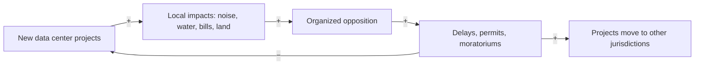

Local impacts build opposition, which can lead to delays, stricter permits or moratoriums. Projects may then move elsewhere, shifting impacts rather than removing them.

**Loop type:** B (balancing)

Read "+" as "more of A leads to more of B" and "−" as "more of A leads to less of B". Every arrow needs a source before this note becomes 🌿 budding.

## Connected notes

- [[branches/communities]]
- [[branches/policy]]
- [[components/site-and-land]]

## Evidence so far

- Data Center Watch counted at least 75 US projects worth about $130 billion blocked or delayed in Q1 2026 ([Q1 2026 report](https://datacenterwatch.org/q1-2026)).
- Its first report lists common concerns: higher utility bills, water consumption, noise, property values and green space ([report](https://datacenterwatch.org/report); summary in [DCD](https://www.datacenterdynamics.com/en/news/group-claims-64bn-in-us-data-center-projects-impacted-by-local-opposition-in-last-two-years/)).

## Could become a model

Mostly qualitative: a case map plus the loop diagram.

## Open questions

- Which arrows are well established, and which are hypotheses?
