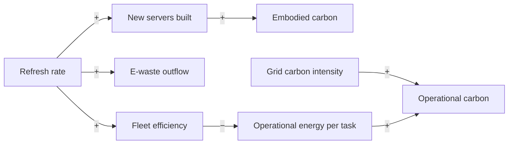

Replacing servers sooner lowers energy per task, but every new server carries manufacturing emissions and creates e-waste.

**Loop type:** Balancing, with a hidden cost

Read "+" as "more of A leads to more of B" and "−" as "more of A leads to less of B". Every arrow needs a source before this note becomes 🌿 budding.

## Connected notes

- [[branches/engineering]]
- [[branches/environment]]
- [[components/servers]]
- [[components/end-of-life]]

## Evidence so far

- Embodied emissions grow in share as grids decarbonize ([Gupta et al.](https://arxiv.org/abs/2011.02839v1)).

## Could become a model

Fleet stock-flow model: refresh cycle and grid carbon sliders, embodied vs operational carbon over time.

## Open questions

- Which arrows are well established, and which are hypotheses?
