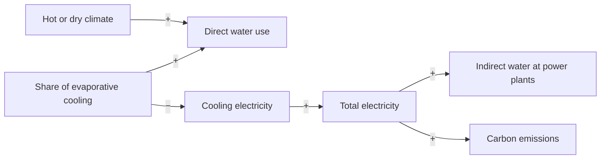

Evaporative cooling saves electricity but uses water on site; dry cooling saves water but uses more electricity, which uses water at power plants.

**Loop type:** Trade-off (balancing)

Read "+" as "more of A leads to more of B" and "−" as "more of A leads to less of B". Every arrow needs a source before this note becomes 🌿 budding.

## Connected notes

- [[branches/engineering]]
- [[branches/environment]]
- [[components/cooling]]
- [[components/power-supply]]

## Evidence so far

- Most of US data centers' operational water footprint was indirect, from electricity ([Siddik et al. 2021](https://eta-publications.lbl.gov/publications/environmental-footprint-data-centers)).
- WUE varies by location and time ([Li et al.](https://arxiv.org/abs/2304.03271v4)).

## Could become a model

Climate-dependent switch: same building, different region.

## Open questions

- Which arrows are well established, and which are hypotheses?
